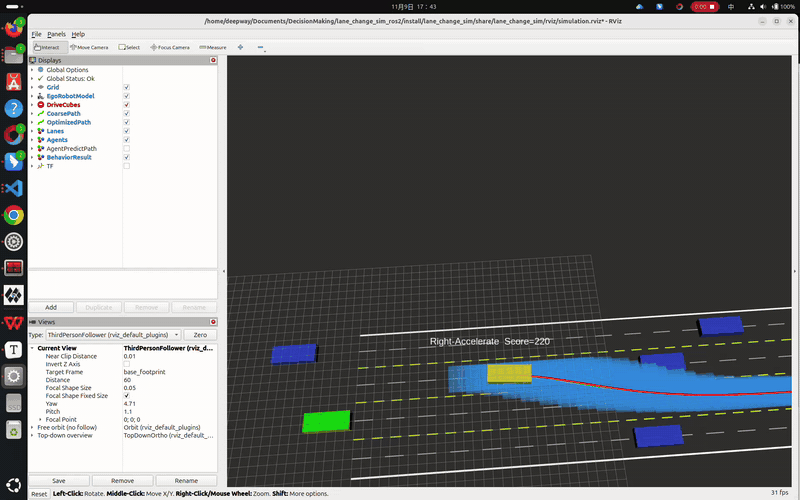

# MTCS_MPDM_NLP ROS2 (Humble/Jazzy) C++ 仿真项目

本项目是 `MTCS_MPDM_NLP` MATLAB 代码的 **ROS2 / C++** 迁移版本（从 ROS1 版本移植），已在 **ROS2 Humble (Ubuntu 22.04)** 与 **ROS2 Jazzy (Ubuntu 24.04)** 下验证编译运行，核心链路为：

- **MCTS** 行为决策（横向 + 纵向）
- **MPDM** 前向多车仿真评估
- **RSS / MOBIL** 安全判据与变道可行性评估
- **安全走廊（DriveCube）** 约束生成
- **非线性轨迹优化**（CasADi/IPOPT + HSL MA27 稀疏线性求解器）
- **RViz2** 可视化（无需额外可视化脚本）

包名：`lane_change_sim`

---

## 1. 算法架构

### 1.1 整体流程

```
┌─────────────────────────────────────────────────────────────────┐
│                    PlannerCore（顶层调度）                       │
│                                                                 │
│  ┌──────────────────────┐     ┌──────────────────────────────┐  │
│  │   BehaviorPlanner    │     │     TrajectoryPlanner        │  │
│  │   (MCTS + MPDM)      │────▶│  (DriveCube + NLP 优化)      │  │
│  └──────────────────────┘     └──────────────────────────────┘  │
│           │                                │                     │
│     粗轨迹 + 决策                    优化轨迹输出                 │
└─────────────────────────────────────────────────────────────────┘
```

### 1.2 行为规划层（BehaviorPlanner）

采用 **MCTS（蒙特卡洛树搜索）+ MPDM（多策略预测决策规划）** 框架：

1. **候选行为生成**：基于 RSS 安全模型 + MOBIL 变道模型筛选可行行为组合
   - 横向：LaneKeeping / LaneChangeLeft / LaneChangeRight / AvoidLeft / AvoidRight
   - 纵向：Maintain / Accelerate / Decelerate
   - RSS 安全距离判据确保变道目标车道前后车距安全
   - MOBIL 增益评估确保变道对自车和目标车道后车均有收益

2. **MCTS 树搜索**：
   - UCB（Upper Confidence Bound）选择策略平衡探索与利用
   - 每层展开候选行为 × 纵向动作的组合
   - 支持 MCTS1（删除失败节点）和标准 MCTS（惩罚保留）两种模式
   - 自适应权重：根据前车距离和相对速度动态调整安全/效率/动作代价权重

3. **MPDM 前向仿真**：
   - 每个叶节点行为执行多车前向仿真（IDM 纵向 + PurePursuit 横向）
   - 自行车运动学模型推进所有车辆状态
   - 碰撞检测（OBB 包围盒）判定仿真可行性
   - 变道状态机（Stage0→Stage1→Stage2→Off）管理变道过程
   - **换道Gap追踪**（`propagateOnceLC`）：变道过程中同时考虑当前车道前车和目标车道gap（前车+后车），通过横向进度动态混合两者的加速度指令，提高变道成功率

4. **轨迹评分**：多维度评分函数
   - **效率代价**：纵向行驶距离 + 低于参考车速惩罚
   - **安全代价**：与周围车辆横向距离倒数惩罚
   - **RSS 代价**：纵向安全距离违反惩罚
   - **动作代价**：行为切换惩罚（变道 > 避让 > 保持）
   - **导航代价**：引导向目标车道和目标位置行驶
   - **影响代价**：对周围车辆造成的减速惩罚

### 1.3 轨迹规划层（TrajectoryPlanner）

1. **安全走廊（DriveCube）生成**：
   - 基于粗轨迹逐时刻生成时空可行域
   - 四方向迭代膨胀（X+/X-/Y+/Y-）直至碰撞或边界
   - OBB 碰撞检测确保膨胀不侵入障碍物
   - 膨胀步数和步长可配置

2. **非线性轨迹优化（CasADi/IPOPT）**：
   - 8 个状态变量（x, y, θ, v, δ, a, ω, jerk）× n 个时间点
   - 自行车运动学等式约束
   - DriveCube 边界不等式约束
   - 加权目标函数：参考跟踪 + 走廊中心吸引 + 转向率/急动度正则化 + 不可行性惩罚
   - 求解器缓存：问题规模不变时复用 CasADi 函数和 IPOPT 实例
   - 热启动（可选）：复用上一帧最优解并平移

3. **Fallback 模式**：无 CasADi 时使用参数化轨迹平滑器

### 1.4 控制层（simulation_node）

- **纵向控制**：规划加速度 + IIDM 安全兜底
- **横向控制**：
  - 直行时：曲率跟踪控制器（前馈 + 反馈）
  - 变道时：行为感知 PurePursuit 控制器
- **变道状态机**（StateManagerRealtime）：
  - Intention 博弈模型（Yield / Aggressive / None）
  - 1 秒冷却期防止连续变道
  - 2 秒漂移超时自动中止
- **交通流多样性**：初始化时给每辆他车赋随机期望速度偏移（`desired_speed = 车道参考速度 ± U(0, traffic_speed_jitter)`），随 `/sim/vehicle_states` 的 `VehicleState.desired_speed` 字段发布，MPDM 前向预测使用同一数值，保证预测与真实行为一致
- **他车意图识别**（simulation_node，`intention_recognition` 开关）：自车产生变道意图时，对目标车道后方关键车辆按实测运动学（TTC/相对速度）判定 Yield（绿）/ Aggressive（红），RViz 中车辆方块实时着色

### 1.5 优化器架构

```
CasADi（建模框架）
  → 符号化生成目标函数、雅可比、海森矩阵
  → 调用 IPOPT（内点法 NLP 求解器）
    → IPOPT 每步牛顿迭代调用 MA27（HSL 稀疏线性求解器）
```

| 组件 | 角色 | 说明 |
|------|------|------|
| **CasADi 3.6.3** | 建模框架 | 自动微分 + 代码生成，构建 NLP 问题；编译时自动下载 |
| **IPOPT** | NLP 求解器 | 内点法求解非线性优化，由 CasADi ExternalProject 自动编译 |
| **HSL (MA27)** | 稀疏线性求解器 | 高效求解 IPOPT 牛顿步中的稀疏对称不定线性方程组 |

> **MUMPS vs MA27**：无 HSL 时 IPOPT 回退使用 MUMPS（开源稀疏求解器），MA27 在 banded 结构问题上通常快 2–5 倍。

---

## 2. 目录结构

```text
lane_change_sim_ros2/
├── CMakeLists.txt              # ament_cmake 构建
├── package.xml                 # ROS2 package manifest (format 3)
├── action/
│   └── RunEpisode.action
├── cmake/
│   └── FindHSL.cmake           # HSL 库查找脚本
├── config/
│   ├── params.yaml
│   └── scenarios/
│       ├── builtin_highway.yaml
│       └── epsilon_highway_lite.yaml
├── include/lane_change_sim/
│   ├── types.hpp               # 核心数据结构
│   ├── ros/msg_adapter.hpp     # ROS2 <-> 内部类型转换
│   ├── scenario/scenario_loader.hpp
│   ├── planner_core.hpp        # 顶层调度器
│   ├── behavior_planner.hpp    # MCTS + MPDM 行为规划
│   ├── trajectory_planner.hpp  # DriveCube + NLP 轨迹优化
│   ├── control/
│   │   ├── common.hpp          # 公共工具（FindLaneById, FindLeadingVehicle）
│   │   ├── idm_controller.hpp  # IDM 纵向控制器
│   │   ├── kinematics.hpp      # 自行车运动学
│   │   ├── lat_controller.hpp  # PurePursuit + CurvatureTracking 横向控制
│   │   ├── rss.hpp             # RSS 安全距离计算
│   │   └── state_manager.hpp   # 变道状态机（Sim + Realtime）
│   └── utils/
│       ├── box2d.hpp           # OBB 碰撞检测
│       ├── collision_utils.hpp # 车辆碰撞工具
│       ├── lane_utils.hpp      # 车道工具
│       ├── math_utils.hpp      # 数学工具
│       └── trajectory_utils.hpp
├── launch/
│   └── simulation.launch.py    # Python launch 文件
├── msg/                        # 14 个自定义消息
├── rviz/
│   └── simulation.rviz         # RViz2 配置
├── scripts/
│   └── install_deps.sh
├── src/
│   ├── scenario/scenario_loader.cpp
│   ├── planner_core.cpp        # 调度：BehaviorPlanner → TrajectoryPlanner
│   ├── behavior_planner.cpp    # MCTS 树搜索 + 轨迹评分
│   ├── forward_simulate.cc     # 前向仿真引擎（propagateOnce/propagateOnceLC/forwardSimulate）
│   ├── trajectory_planner.cpp  # DriveCube + CasADi/IPOPT 轨迹优化
│   ├── scene_node.cpp          # 场景节点
│   ├── planner_node.cpp        # 规划节点
│   └── simulation_node.cpp     # 仿真控制节点
├── srv/
│   └── ResetScenario.srv
├── ThirdParty/
│   └── coinhsl-archive-*/      # HSL 稀疏线性代数库源码
└── urdf/main_car/
    └── car.xacro + ...
```

### 核心模块说明

| 模块 | 文件 | 功能 |
|------|------|------|
| **BehaviorPlanner** | `behavior_planner.hpp/cpp` | MCTS 树构建与搜索、轨迹评分（效率/安全/RSS/动作/导航/影响代价） |
| **ForwardSimulator** | `forward_simulate.cc` | 前向仿真引擎：标准IDM跟车（`propagateOnce`）、换道Gap追踪（`propagateOnceLC`）、多步仿真（`forwardSimulate`） |
| **TrajectoryPlanner** | `trajectory_planner.hpp/cpp` | 语义走廊（DriveCube）约束生成、初始猜测（支持热启动）、CasADi/IPOPT 非线性轨迹优化 |
| **PlannerCore** | `planner_core.hpp/cpp` | 两层级联调度，协调行为→轨迹完整规划链 |

---

## 3. 节点架构（发布/订阅/服务/动作）

### scene_node

- 发布：
  - `/scene/lanes` (`LaneArray`，transient_local)
  - `/scene/vehicle_states` (`VehicleArray`)
  - `/scene/vehicle_set` (`VehicleSet`，transient_local)
  - `/scene/arena_info_static` (`ArenaInfoStatic`，transient_local)
  - `/scene/arena_info_dynamic` (`ArenaInfoDynamic`)
  - `/scene/visualization` (`MarkerArray`)
- 服务：
  - `/scene/reset` (`ResetScenario`)

作用：加载并维护场景（内置 / EPSILON），发布静态场景与车道可视化。

### planner_node

- 订阅：
  - `/sim/vehicle_states`
  - `/scene/lanes`
- 发布：
  - `/planner/decision` (`BehaviorDecision`)
  - `/planner/trajectory` (`Trajectory`)
  - `/planner/coarse_trajectory` (`Trajectory`)
  - `/planner/visualization` (`MarkerArray`)
  - `/planner/cubes` (`MarkerArray`)
  - `/planner/decision_text` (`MarkerArray`)
- 动作：
  - `/planner/run_episode` (`RunEpisode`)

作用：执行 MCTS + MPDM + 轨迹优化，输出当前周期决策和轨迹。

### simulation_node

- 订阅：
  - `/scene/lanes`
  - `/scene/vehicle_states`（仅初始化）
  - `/planner/decision`
  - `/planner/trajectory`
  - `/planner/coarse_trajectory`
- 发布：
  - `/sim/vehicle_states`
  - `/sim/opt_path` (`nav_msgs/Path`)
  - `/sim/coarse_path` (`nav_msgs/Path`)
  - `/sim/visualization` (`MarkerArray`)
  - `/sim/decision_text` (`std_msgs/String`)
  - `/sim/joint_states` (`sensor_msgs/JointState`)

作用：主控制循环推进车辆状态并反馈给规划器。

---

## 4. 场景定义

- 车道中心：`y = [2, 6, 10, 14]`（4 车道）
- 目标：`target_lane_id = 2`，`target_x = 200m`
- 车辆初始状态：ego + 6 辆交通车

也支持 EPSILON `highway_lite` 场景导入：
- 读取：`lane_net_norm.json` + `vehicle_set.json`
- 配置：`config/scenarios/epsilon_highway_lite.yaml`
- 加载器自动做坐标对齐、车道聚类和 lane_id 归一化

---

## 5. 依赖安装

### 5.1 ROS2 依赖

按你的发行版把 `$ROS_DISTRO` 替换为 `humble` 或 `jazzy`（已安装 ros-desktop-full 的话大多已包含）：

```bash
sudo apt-get update
sudo apt-get install -y \
  ros-$ROS_DISTRO-rviz2 \
  ros-$ROS_DISTRO-robot-state-publisher \
  ros-$ROS_DISTRO-xacro \
  ros-$ROS_DISTRO-nav-msgs \
  ros-$ROS_DISTRO-visualization-msgs \
  ros-$ROS_DISTRO-tf2-ros \
  ros-$ROS_DISTRO-sensor-msgs
```

> 不需要 `joint-state-publisher`：`/sim/joint_states` 由 simulation_node 直接发布给 robot_state_publisher。
>
> ⚠️ `scripts/install_deps.sh` 是 ROS1 时代遗留脚本（安装 noetic 包），**不要使用**。

### 5.2 编译工具链

```bash
sudo apt-get install -y \
  gfortran \
  liblapack-dev \
  libopenblas-dev \
  libboost-dev
```

### 5.3 CasADi + IPOPT（自动）

CasADi 3.6.3 和 IPOPT 通过 CMake `ExternalProject` 自动下载和编译，**无需手动安装**。首次 `colcon build` 时会从 GitHub 下载 CasADi 源码并编译（含 IPOPT），耗时较长，后续编译使用缓存。

> 需要网络连接。如遇 SSL 证书错误，可设置环境变量 `export GIT_SSL_NO_VERIFY=1` 后重试。

### 5.4 HSL 稀疏线性求解器（推荐，手动）

HSL (MA27) 可显著提升 IPOPT 求解速度（2–5 倍）。需要手动获取：

1. 访问 [STFC IP Store - Coin-HSL Archive](https://licences.stfc.ac.uk/product/coin-hsl-archive)，注册并下载（学术/商业均免费）
2. 将源码包解压至 `ThirdParty/` 目录
3. 编译时 CMake 会自动检测 `ThirdParty/coinhsl-archive-*/` 并编译

**无 HSL 时**：IPOPT 自动回退使用 MUMPS 线性求解器，功能完全正常，仅速度较慢。

> ⚠️ 解压后若源码包内脚本缺少执行权限（常见于经 Windows/网盘中转的 zip），`configure` 会报 `Permission denied`。修复：
> ```bash
> chmod +x ThirdParty/coinhsl-archive-*/{configure,install-sh,missing,compile,config.guess,config.sub,depcomp,ltmain.sh}
> ```

### 5.5 Python 工具（colcon / lark）

```bash
pip install -U colcon-common-extensions   # 构建工具（若无 colcon）
pip install lark                          # rosidl 消息生成依赖；用 conda Python 时通常缺失需补装（系统 apt 安装的 ROS 自带）
```

**使用 Anaconda/Miniconda 的注意**：conda base 默认激活时自带旧版 `libstdc++`，可能导致 `import rclpy` 报 `GLIBCXX_3.4.30 not found`、`ros2` CLI 静默失败。两种解法任选：

```bash
conda install -y -n base -c conda-forge "libstdcxx-ng>=13"   # 升级 conda 副本（推荐）
# 或
conda config --set auto_activate_base false                  # 或运行 ROS 前 conda deactivate
```

---

## 6. 编译

```bash
cd ~/your_ros2_ws
source /opt/ros/humble/setup.bash      # 或 jazzy
colcon build --packages-select lane_change_sim --cmake-args -DCMAKE_BUILD_TYPE=Release
source install/setup.bash
```

首次编译会下载并编译 CasADi + IPOPT + HSL（约 10–20 分钟，需联网）。后续增量编译很快。

> HSL 源码存在于 `ThirdParty/` 时默认启用（CMake 选项 `WITH_HSL` 默认 ON）；如需强制关闭：`-DWITH_HSL=OFF`。
>
> 运行时无需手动设置 `LD_LIBRARY_PATH`：vendored 的 `libcasadi*.so` 等已安装到 `install/lane_change_sim/lib/`，`source install/setup.bash` 会自动包含。

---

## 7. 运行

```bash
source /opt/ros/humble/setup.bash      # 或 jazzy（已写入 ~/.bashrc 则省略）
source install/setup.bash

# 默认场景
ros2 launch lane_change_sim simulation.launch.py

# 指定场景和安全模式
ros2 launch lane_change_sim simulation.launch.py scenario_profile:=builtin_highway safety_mode:=conservative

# 其他安全模式
ros2 launch lane_change_sim simulation.launch.py safety_mode:=aggressive
ros2 launch lane_change_sim simulation.launch.py safety_mode:=standard
```

RViz2 默认加载：`rviz/simulation.rviz`（窗口默认近全屏尺寸、追尾视角跟随自车；可在 Views 面板切换到 Free orbit / Top-down overview）。

> **回合结束行为**：自车到达 `target_x`（默认 200m，约 25–30s）或超过 `max_sim_time` 后仿真冻结（车辆/轨迹/TF 停更，车道继续发布）。重跑请重新 launch；想复现同一随机场景用 `traffic_speed_seed:=N`。

运行时日志示例：
```
[TrajectoryPlanner] DriveCube generation: 1.23 ms (20 cubes)
[TrajectoryPlanner] Optimizer: 2.55 ms (CasADi/IPOPT)
```

### 运行效果（可视化）



上图为 RViz2 追尾视角仿真录屏（自车居中，周围可见他车着色、车道线、安全走廊与红/绿轨迹），画面元素对照：

| 元素 | 外观 | 数据源 |
|------|------|--------|
| 自车 | 🟡 黄色方块（叠加 URDF 车模） | `/sim/visualization` + `EgoRobotModel` |
| 让行意图他车 | 🟢 绿色方块 | `/sim/visualization`（`intention_recognition`） |
| 抢道意图他车 | 🔴 红色方块 | 同上 |
| 普通他车 | 🔵 蓝色方块 | 同上 |
| 车道中心线 / 边界线 | 白色虚线 / 黄白实线 | `/scene/visualization` |
| 安全走廊 DriveCube | 半透明蓝色立方体阵列 | `/planner/cubes` |
| 粗轨迹 / 优化轨迹 | 绿色线 / 红色线 | `/sim/coarse_path` `/sim/opt_path` |
| 决策文字 | 自车顶上方文字（如 `Right-Accelerate`） | `/planner/decision_text` |

视角默认**追尾跟随自车**（ThirdPersonFollower，锁定 `base_footprint`）：左键旋转、滚轮缩放、右键推拉、`F` 聚焦、`Z` 复位；Views 面板可切换 `Free orbit`（不跟车）与 `Top-down overview`（正俯视全局）。

录屏素材（1280×800，6.6s）：[`docs/simulation_demo.mp4`](docs/simulation_demo.mp4)。想复现类似含变道的画面，加大交通速度差异即可：

```bash
ros2 launch lane_change_sim simulation.launch.py traffic_speed_jitter:=4.0
```

---

## 8. 参数配置

参数文件：`config/params.yaml`

场景配置文件：`config/scenarios/*.yaml`

### MCTS / MPDM 参数

| 参数 | 默认值 | 说明 |
|------|--------|------|
| `sim_time` | 9.0 | 总仿真时域 [s] |
| `sim_ts` | 0.3 | 仿真步长 [s] |
| `ctrl_ts` | 0.1 | 控制步长 [s] |
| `tree_hight` | 3 | MCTS 树深度 |
| `mcts_delete_on_failure` | true | true=MCTS1(删除失败节点), false=MCTS(惩罚-1000) |

### 车辆动力学限制

| 参数 | 默认值 | 说明 |
|------|--------|------|
| `max_v` | 10.0 | 最大速度 [m/s] |
| `max_a` / `min_a` | 3.0 / -5.0 | 最大/最小加速度 [m/s²] |
| `max_j` | 5.0 | 最大加加速度 [m/s³] |
| `max_delta` | 0.5 | 最大前轮转角 [rad] |
| `max_steer` | 0.2 | 控制最大转角 [rad] |
| `max_steer_rate` | 0.5 | 最大转角速率 [rad/s] |

### 评分权重

| 参数 | 默认值 | 说明 |
|------|--------|------|
| `effic_cost` | 2.0 | 效率代价权重 |
| `safe_cost` | 10.0 | 安全代价权重 |
| `action_cost` | 10.0 | 动作切换代价权重 |
| `navi_cost` | 5000.0 | 导航引导代价权重 |
| `affect_cost` | 5.0 | 影响代价权重 |
| `rss_cost` | 30.0 | RSS 违反代价权重 |
| `fade_factor` | 0.8 | 时间衰减因子 |

### 轨迹优化参数

| 参数 | 默认值 | 说明 |
|------|--------|------|
| `traj_time` | 6.0 | 优化时域 [s] |
| `traj_ts` | 0.1 | 优化步长 [s] |
| `weight_penalty` | 1e5 | 不可行性惩罚权重 |
| `weight_x/y/theta` | 5.0 | 参考轨迹跟踪权重 |
| `weight_cube_center_x/y` | 2.0/6.0 | 安全走廊中心吸引权重 |
| `weight_omega` | 100.0 | 转向率正则化权重 |
| `weight_jerk` | 1.0 | 急动度正则化权重 |

### IPOPT 求解器参数

| 参数 | 默认值 | 说明 |
|------|--------|------|
| `ipopt_max_iter` | 80 | 最大迭代次数 |
| `ipopt_tol` | 1e-4 | 主收敛容差 |
| `ipopt_acceptable_tol` | 1e-4 | 可接受解容差 |
| `ipopt_acceptable_iter` | 10 | 连续满足 acceptable_tol 几次即停止 |
| `ipopt_mu_strategy` | "monotone" | 障碍参数更新策略 |
| `warm_start_enable` | false | 是否启用热启动 |

### 自适应权重

| 参数 | 默认值 | 说明 |
|------|--------|------|
| `adapt_weights_enable` | true | 是否启用自适应权重 |
| `adapt_front_dist_near` | 10.0 | 前车距离近阈值 [m] |
| `adapt_front_dist_far` | 50.0 | 前车距离远阈值 [m] |

### 换道Gap追踪参数

| 参数 | 默认值 | 说明 |
|------|--------|------|
| `lc_gap_tracking_enable` | true | 是否启用换道Gap追踪 |
| `lc_gap_headway_time` | 1.0 | Gap安全距离的时间头 [s] |
| `lc_gap_min_dist` | 2.0 | 最小静态Gap距离 [m] |
| `lc_ctx_weight_cur` | 0.4 | 当前车道IDM权重 |
| `lc_ctx_weight_tar` | 0.8 | 目标Gap追踪权重 |
| `lc_gap_kp` | 0.1 | 位置误差→速度修正的P增益 |
| `lc_gap_dv_lb` | -3.0 | 速度修正下界 [m/s] |
| `lc_gap_dv_ub` | 5.0 | 速度修正上界 [m/s] |

### 交通流与意图识别参数（simulation_node）

| 参数 | 默认值 | 说明 |
|------|--------|------|
| `traffic_speed_jitter` | 2.0 | 他车期望速度随机偏移幅度 [m/s]（0=关闭，全体回退到车道参考速度） |
| `traffic_ref_speed` | 7.0 | 初始化时车道信息未就绪的兜底基准速度 [m/s] |
| `traffic_speed_seed` | 0 | 0=每次启动新随机场景；N>0 可复现 |
| `intention_recognition` | true | 行为化他车意图识别（Yield=绿 / Aggressive=红 / None=蓝） |

---

## 9. 常见问题

### Q1: 编译时 CasADi 下载失败
```bash
export GIT_SSL_NO_VERIFY=1
colcon build --packages-select lane_change_sim
```

### Q2: 编译时提示 HSL 未找到
正常现象——如果 `ThirdParty/` 下没有 HSL 源码，编译自动使用 MUMPS。如需 MA27 加速，参见 §5.4。

### Q3: 如何确认 MA27 已生效
运行时日志会显示 `CasADi/IPOPT+MA27`（而非 `CasADi/IPOPT`）。

### Q4: 优化器耗时较长
- 确认使用 Release 编译：`-DCMAKE_BUILD_TYPE=Release`
- 确认 MA27 已启用（见 Q3）
- 启用热启动：`warm_start_enable: true`
- 减小问题规模：`traj_ts: 0.2`（从 61 个时间点降到 31 个）
- 放宽收敛条件：增大 `ipopt_tol`

### Q5: RViz2 中看不到车辆/车道（MarkerArray 不显示）
- 确认 `Fixed Frame` 设为 `map`
- **检查 `.rviz` 配置中 MarkerArray 显示项的键名**：RViz2 必须是 `Topic:`，旧配置里的 `Marker Topic:`（RViz1 键名）会被**静默忽略**，不报错、不订阅——可用 `ros2 topic info /scene/visualization -v` 看 Subscription count 是否为 1 验证
- 检查 TF 树中 `map` → `base_footprint` 是否存在
- 若画面中途"冻住"：多半是自车已到达 `target_x`，回合结束（见 §7 说明）

### Q6: conda 环境下 rclpy / ros2 CLI 报错或静默无输出
见 §5.5。典型症状：`import rclpy` 报 `GLIBCXX_3.4.30 not found`，或 `ros2 topic echo` 一直无输出。根因是 conda 自带旧 libstdc++ 抢先加载。

### Q7: 所有他车速度看起来一样 / 自车从不换道
期望速度随机偏移（§8 交通流参数）未生效或被 `traffic_speed_jitter: 0` 关闭。把 jitter 调到 2–3 可显著提升换道触发频率。

---

## 10. 后续建议

- 增加 `/planner/debug` 话题输出每层 MCTS 树统计（N/T/UCB）
- 增加回放记录（rosbag2）用于逐周期对比调试与场景复现
- 增加 gtest（行为决策与碰撞检测单元测试）
- 评估 CasADi codegen 进一步提升 NLP 函数求值速度
- 考虑使用 `rclcpp_components` 将节点组合为组件以减少通信开销
